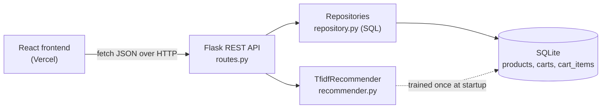

# Furniture Store: Search & Recommendations

A full-stack e-commerce demo: search a furniture catalogue, filter and sort results, see "You may also like" recommendations, and manage a shopping cart.

- **Backend:** Python, Flask REST API, SQLite (raw SQL), scikit-learn
- **Frontend:** React (Vite), JavaScript, CSS
- **Tests:** 22 automated API and unit tests (`unittest`)

> The 200-product catalogue is synthetic: it is generated by `backend/app/seed.py`, not taken from any real store.

## Features

- Keyword search across name, description, material, colour and style (every word must match)
- Filters for category and price range; sort by relevance, price or rating; pagination
- "Relevance" ranks products by a Bayesian-average rating, so a 5.0 with 2 reviews doesn't beat a 4.7 with 600
- Content-based recommendations using TF-IDF and cosine similarity, plus a same-category boost
- Shopping cart with add, update quantity and remove; it survives a page reload
- Input validation with clear JSON errors, SQL-injection-safe queries, and a CORS allow-list

## Architecture



| Layer | File | Responsibility |
|---|---|---|
| HTTP | `backend/app/routes.py` | Parse and validate requests, return JSON |
| Domain | `backend/app/models.py` | `Product`, `CartItem`, `Cart` classes and business rules (totals, quantity limits) |
| Data | `backend/app/repository.py` | All SQL queries (repository pattern) |
| ML | `backend/app/recommender.py` | Abstract `Recommender` with two implementations |
| UI | `frontend/src/` | Components, a custom `useCart` hook, and one `api.js` module for all requests |

## API

| Method | Endpoint | Description |
|---|---|---|
| GET | `/api/health` | Health check |
| GET | `/api/categories` | Categories with product counts and price ranges |
| GET | `/api/products?q=&category=&min_price=&max_price=&sort=&page=&page_size=` | Search with filters |
| GET | `/api/products/{id}` | One product |
| GET | `/api/products/{id}/similar?k=4` | Recommended similar products |
| POST | `/api/carts` | Create a cart |
| GET | `/api/carts/{id}` | Cart with items and subtotal |
| POST | `/api/carts/{id}/items` | Add a product: `{"product_id": 1, "quantity": 2}` |
| PUT | `/api/carts/{id}/items/{product_id}` | Set quantity: `{"quantity": 3}` |
| DELETE | `/api/carts/{id}/items/{product_id}` | Remove a product |

`sort` is one of `relevance`, `price_asc`, `price_desc`, `rating`.

## Run it locally

**Backend** (Python 3.10+):

```bash
cd backend
python -m venv .venv
source .venv/bin/activate          # Windows: .venv\Scripts\activate
pip install -r requirements.txt
python run.py                      # http://localhost:5000/api/health
```

**Frontend** (Node 18+), in a second terminal:

```bash
cd frontend
npm install
cp .env.example .env               # Windows: copy .env.example .env
npm run dev                        # http://localhost:5173
```

**Tests:**

```bash
cd backend
python -m unittest -v
```

## Deploy

**Backend on Render** (free web service):
- Root directory: `backend`
- Build command: `pip install -r requirements.txt`
- Start command: `gunicorn wsgi:app`
- Environment variable: `ALLOWED_ORIGINS=https://<your-frontend>.vercel.app`

**Frontend on Vercel:**
- Root directory: `frontend` (Vercel detects Vite automatically)
- Environment variable: `VITE_API_URL=https://<your-backend>.onrender.com`

On Render's free tier the SQLite file is reset on each redeploy, so carts are cleared. The catalogue is regenerated automatically.

## Design decisions

- **Raw SQL with `?` placeholders** instead of an ORM, so every query is visible and injection-safe. Sort options come from a fixed allow-list, never from user text.
- **Indexes** on `category`, `price` and `rating` for the most common filters and sorts.
- **Upsert** (`INSERT ... ON CONFLICT DO UPDATE`) adds an item or updates its quantity in one query.
- **Abstract `Recommender` class:** `CategoryRecommender` (simple baseline) and `TfidfRecommender` share one interface, so either can be swapped in without changing the routes.
- **Debounced search** in React: the API is called 300 ms after the user stops typing, not on every keystroke.

## Possible next steps

- PostgreSQL instead of SQLite for persistent production data
- Full-text search (SQLite FTS5 or PostgreSQL `tsvector`) for ranking by text relevance
- User accounts and order checkout
- Collaborative-filtering recommendations once there is real user behaviour data

## AI-assisted development

This project was built with Claude as an AI pair programmer: generating the initial structure, tests and styles, and helping debug. Every change was reviewed and run before committing.
