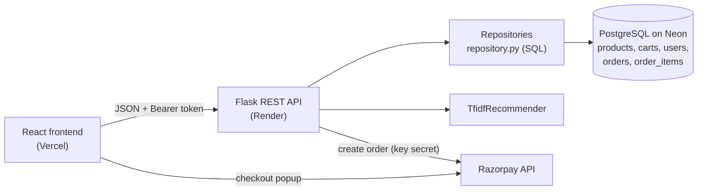

# Furniture Store: Search, Recommendations & Checkout

A full-stack e-commerce app: search a furniture catalogue, get "You may also like"
recommendations, sign up and log in, and buy with **Buy Now** or from the cart,
paying through **Razorpay** (test mode).

- **Backend:** Python, Flask REST API, PostgreSQL (Neon) in production / SQLite locally, scikit-learn
- **Auth:** email + password, hashed with scrypt, JWT bearer tokens
- **Payments:** Razorpay Orders API + server-side HMAC-SHA256 signature verification
- **Frontend:** React (Vite), JavaScript, CSS
- **Tests:** 50 automated tests, run against both SQLite and PostgreSQL

> The 200-product catalogue is synthetic: generated by `backend/app/seed.py`, not taken from a real store.
> Payments run in Razorpay **test mode**: use test cards, no real money moves.

## Features

- Keyword search (every word must match), category and price filters, sorting, pagination
- "Relevance" sort uses a Bayesian-average rating, so 5.0 with 2 reviews doesn't beat 4.7 with 600
- Content-based recommendations: TF-IDF + cosine similarity with a same-category boost
- Cart that survives a page reload
- Sign up / log in; passwords are never stored, only salted hashes
- **Buy Now** or checkout the whole cart, with a validated Indian delivery address
- Razorpay checkout; the server verifies every payment signature before marking an order paid
- Order history and order details; users can only ever see their own orders
- A photo per product, falling back to a category photo, then a coloured tile

## Architecture



### How a payment works

1. The browser sends the product (or cart) and address to `POST /api/orders`.
2. The server prices the order **from the database** (never from the browser), saves it as `pending`,
   and creates a Razorpay order for the amount in paise.
3. The browser opens Razorpay's popup with that Razorpay order id; the user pays.
4. Razorpay returns `payment_id`, `order_id` and a `signature` to the browser, which forwards them to
   `POST /api/orders/<id>/verify`.
5. The server recomputes `HMAC-SHA256(key_secret, "order_id|payment_id")`. Only Razorpay and the server
   know the secret, so a matching signature proves the payment is genuine. Then the order is `paid`
   and the cart is emptied.

| Layer | File | Responsibility |
|---|---|---|
| HTTP | `routes.py`, `auth.py`, `orders.py` | Validate requests, return JSON |
| Domain | `models.py` | `Product`, `Cart`, `User`, `Address`, `Order`: business rules |
| Data | `repository.py`, `db.py` | All SQL; one `Database` class for SQLite and PostgreSQL |
| Payments | `payments.py` | Abstract `PaymentGateway` + `RazorpayGateway` |
| ML | `recommender.py` | Abstract `Recommender` + TF-IDF implementation |
| UI | `frontend/src/` | Pages, components, hooks (`useAuth`, `useCart`, `useHashRoute`), `api.js` |

## API

| Method | Endpoint | Login? | Description |
|---|---|---|---|
| GET | `/api/products?q=&category=&min_price=&max_price=&sort=&page=` | | Search |
| GET | `/api/products/{id}` · `/api/products/{id}/similar` | | Product · recommendations |
| GET | `/api/categories` | | Categories with counts |
| POST/GET | `/api/carts` · `/api/carts/{id}` | | Create / read a cart |
| POST/PUT/DELETE | `/api/carts/{id}/items[/{product_id}]` | | Add / set quantity / remove |
| POST | `/api/auth/signup` · `/api/auth/login` | | Returns `{token, user}` |
| GET | `/api/auth/me` | ✔ | The logged-in user |
| POST | `/api/orders` | ✔ | `{product_id, quantity}` or `{cart_id}`, plus `address` |
| POST | `/api/orders/{id}/verify` | ✔ | Razorpay payment response |
| GET | `/api/orders` · `/api/orders/{id}` | ✔ | Order history · one order |

Logged-in requests send `Authorization: Bearer <token>`.

## Run it locally

**Backend** (Python 3.10+). Uses a local SQLite file, so no database setup is needed:

```bash
cd backend
python -m venv .venv
.venv\Scripts\activate             # Mac/Linux: source .venv/bin/activate
pip install -r requirements.txt
python run.py                      # http://localhost:5000/api/health
```

To test payments locally, set your Razorpay **test** keys before `python run.py`:

```powershell
$env:RAZORPAY_KEY_ID="rzp_test_..."; $env:RAZORPAY_KEY_SECRET="..."
```

**Frontend** (Node 18+), in a second terminal:

```bash
cd frontend
npm install
copy .env.example .env             # Mac/Linux: cp .env.example .env
npm run dev                        # http://localhost:5173
```

**Tests:**

```bash
cd backend
python -m unittest -v
# Same tests on PostgreSQL (uses an EMPTY test database; it is wiped):
# TEST_DATABASE_URL=postgresql://... python -m unittest
```

**Test payment details** (Razorpay test mode, from
[Razorpay's docs](https://razorpay.com/docs/payments/payment-gateway/s2s-integration/json/v2/test-integration.md)):
Visa `4386 2894 0766 0153` or Mastercard `5267 3181 8797 5449`, any future expiry, any CVV;
or UPI `success@razorpay` (and `failure@razorpay` to test a failed payment).

## Deploy

**Database: Neon**: create a free project and copy the connection string.
Tables and the 200 products are created automatically on first start.

**Backend: Render** (root directory `backend`, build `pip install -r requirements.txt`,
start `gunicorn wsgi:app`). Environment variables, all listed in `backend/.env.example`:

| Variable | Value |
|---|---|
| `DATABASE_URL` | Neon connection string |
| `SECRET_KEY` | long random string: `python -c "import secrets; print(secrets.token_hex(32))"` |
| `ALLOWED_ORIGINS` | your Vercel URL, no trailing slash |
| `RAZORPAY_KEY_ID` / `RAZORPAY_KEY_SECRET` | Razorpay test keys |
| `PYTHON_VERSION` | `3.11.9` |

**Frontend: Vercel** (root directory `frontend`), with `VITE_API_URL` = your Render URL.

## Product photos

Put photos in `frontend/public/images/products/` named by product id (`1.jpg` … `200.jpg`).
`docs/product-photos.csv` lists every id, product name and a suggested search term.

## Design decisions

- **One SQL dialect in the code:** `Database` (db.py) converts `?` placeholders for PostgreSQL, so every
  query runs unchanged on both databases; only the schema files differ.
- **Parameterized SQL everywhere**, and sort orders from a fixed allow-list: no SQL injection.
- **Server-side pricing:** order totals come from the database, so editing prices in the browser does nothing.
- **Price snapshot:** `order_items.unit_price` keeps the price paid even if the product price changes later.
- **Transactions:** an order and its items are saved together or not at all; payment + emptying the cart too.
- **Auth hardening:** same error for wrong email or wrong password, constant-time checks, tokens expire in 7 days.
- **Abstract `PaymentGateway`:** tests use a fake gateway with the same interface: no network, no real money.

## Possible next steps

- Razorpay **webhooks**, so orders are marked paid even if the user closes the tab right after paying
- Rate-limiting login attempts; password reset by email
- Admin pages for products and orders; stock levels
- Full-text search (PostgreSQL `tsvector`)

## AI-assisted development

Built with Claude as an AI pair programmer: generating structure, tests and styles, and helping debug.
Every change was reviewed and run before committing.
